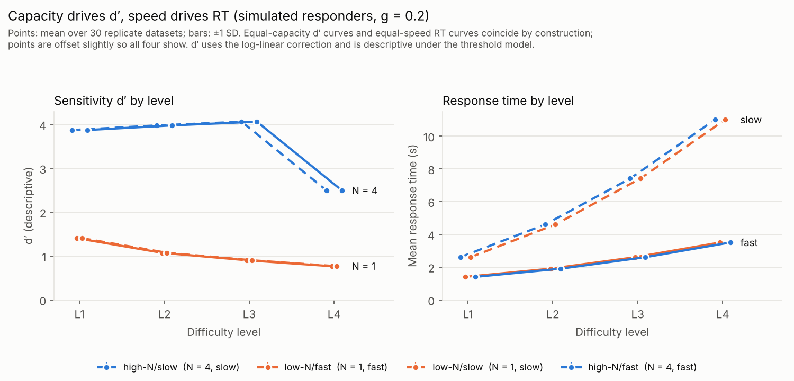

# change-detection

A synthetic, text-only **change-detection** task. A procedural generator describes
sequences of panels in text. The question for each item is *"Which of these
attributes change across panels?"*. Answers are scored per attribute with signal
detection theory (SDT), and accuracy and response time are kept as separate
measures. Simulated responders with known properties validate the analysis.

Scope: change detection only. No rule verification, no rule generation, no
API calls (simulated responders only).



## Quick start

```bash
pip install -r requirements.txt          # pinned versions, Python 3.13
pytest -q                                # 86 tests, ~20 s
PYTHONPATH=src python scripts/run_validation.py   # ~3 min, writes results/validation.{json,md}
PYTHONPATH=src python scripts/make_figure.py      # writes results/figure_dprime_rt.png
```

Alternatively, run `pip install -e .` and drop the `PYTHONPATH=src`.

## Method

### Items

Each item has 3 panels. Each panel describes `n_objects` object groups, e.g.
"There are 3 large striped red circles at the top-left." Objects carry the
**queried** attributes (a subset of `shape, size, color, position, count`)
plus optional **distractor** attributes (`texture, orientation`).

Example (level 1):

```
Panel 1: There is 1 object at the bottom-right. There are 4 objects at the bottom-right.
Panel 2: There is 1 object at the top-right. There are 4 objects at the bottom-right.
Panel 3: There is 1 object at the top-right. There are 4 objects at the bottom-right.

Question: Which of these attributes change across panels: position, count?
End your answer with one line of the form 'CHANGED: <attributes separated by commas>' or 'CHANGED: none'.
```

Ground truth: `position` changed, `count` unchanged.

Every question lists exactly its queried attributes and never names a
distractor. The prompt also tells the respondent that reordering and
equivalent wording do not count as changes.

### Difficulty knobs (`changedet.generator.Knobs`)

| knob | range | effect |
|---|---|---|
| `n_objects` | 1–6 | object groups per panel |
| `n_attrs` | 1–5 | queried attributes per object |
| `n_changed` | 0–`n_attrs` | how many queried attributes change |
| `surface_noise` | 0–3 | irrelevant wording variation (see below) |
| `n_distractors` | 0–2 | unqueried attributes that do change |

The two kinds of irrelevant variation are separate knobs, and neither ever
changes the ground truth:

* `surface_noise` adds up level by level: 1 shuffles the object order in each panel; 2
  adds synonyms (large/big, 3/three, red/scarlet, "at the top-left"/"in the
  upper-left corner"); 3 adds varied sentence templates.
* `n_distractors` adds texture and/or orientation, which change across panels
  but are never asked about.

**Levels** (`LEVELS`) are presets that raise every knob together. Within a
level, `n_changed` is uniform over `0..n_attrs`:

| level | n_objects | n_attrs | surface_noise | n_distractors | load (comparisons) |
|---|---|---|---|---|---|
| L1 | 2 | 2 | 0 | 0 | 8 |
| L2 | 3 | 3 | 1 | 1 | 18 |
| L3 | 4 | 4 | 2 | 1 | 32 |
| L4 | 5 | 5 | 3 | 2 | 50 |

Use `generate_items(Knobs(...), n, seed)` to vary one knob at a time.

### Scoring (`changedet.scoring`)

The response is parsed (`changedet.parse`) and each queried attribute becomes
one trial: hit, miss, false alarm or correct rejection. The analysis reports
the following per difficulty level, **separately**:

* **SDT:** hit and false-alarm rates, d′ and criterion c;
* **Accuracy:** proportion of correct trials, and exact-match rate per item;
* **Response time (RT):** mean and SD in seconds.

### Simulated responders (`changedet.responders`)

Each simulated responder has three independent parameters:

| parameter | meaning |
|---|---|
| `N` (capacity) | detects a random subset of `min(N, n_changed)` changing attributes |
| `g` (bias) | each undetected attribute (changed or not) is reported with probability `g` |
| `s` (speed) | RT = `t0 + s · load + ε`, with `load = n_objects × n_attrs × (n_panels − 1)` and ε ~ N(0, σ); defaults `t0 = 1 s`, `σ = 0.3 s` |

Responders write free text ending in a `CHANGED:` line, sometimes using
aliases such as "colour". So the parser runs on every simulated response.

### Parameter recovery (`changedet.fit`)

* **(N, g):** an exact per-item likelihood. For an item with `k = n_changed`
  changing and `m` unchanged attributes, hits = `min(N, k) + Binomial(k − min(N, k), g)`
  and false alarms = `Binomial(m, g)`. Items with `k = 0` contribute
  false-alarm trials only. For each N, the maximum-likelihood ĝ has a
  closed form (reported guess trials / all guess trials). N is chosen by grid
  search over `0..max(k)`, and ties go to the smallest N.
* **Speed:** an OLS regression of RT on load gives the slope ŝ and intercept t̂0,
  with classical standard errors.
* A parametric bootstrap (`validation.parametric_bootstrap`) gives 95% CIs.

## Conventions

* **What counts as a change:** a queried attribute is *changed* if its value
  differs for at least one object between two consecutive panels. At each
  transition, a changing attribute changes for exactly one object, so swaps
  cannot happen. Every change therefore shows up as a difference in the
  multiset of that attribute's values, and the ground truth can be recovered
  from the text alone, even with shuffled order and no object IDs. A test
  decodes every panel from its text and checks this.
* **Unit of judgment:** one judgment per queried attribute type per item,
  pooled over objects. There is no "which object" judgment.
* **SDT correction:** the log-linear correction (Hautus, 1995),
  H = (hits + 0.5)/(n_signal + 1) and likewise for F, is applied to every
  cell, so d′ and c are always finite. d′ = z(H) − z(F) and c = −(z(H) + z(F))/2.
  Negative c means a bias toward reporting change.
* **RT definition:** simulated seconds from item onset to response. It is
  generated by the speed model above and is not measured from any real
  process. RT is reported separately from accuracy and never folded into it.
* **Parsing:** only the last `CHANGED:` line counts. An unparseable response
  is scored as "nothing reported" and counted (`unparseable_rate`). Reported
  attributes that were not queried, such as distractors, are ignored and
  counted (`extraneous_reports`).
* **Naming:** `n_changed` is the number of changing attributes. `c` always
  means the SDT criterion.
* **Seeds:** every random step is seeded via `numpy.random.default_rng` /
  `SeedSequence`. Items: `generate_set(level, n, seed)` seeds with `[seed, level]`.
  Responders use two separate streams (decisions and RT noise) spawned from one seed.
  Validation items use seed 2026, and the regression snapshot uses seed 12345.

## Validation and tolerances

`scripts/run_validation.py` fits 24 grid responders (N ∈ {1,2,3,4} × g ∈ {0.05, 0.2, 0.4}
× s ∈ {0.05, 0.20} s per comparison) on 1,600 items (400 per level), over 50
independent replicate datasets each. It also fits four **dissociated** responders:
high-N/slow, low-N/fast, low-N/slow and high-N/fast. Full output is in
[`results/validation.md`](results/validation.md).

Pass criteria and their justification:

| quantity | criterion | why |
|---|---|---|
| N | N̂ = N in ≥ 95% of replicate datasets | N is discrete, so the target is near-certain identification rather than closeness. |
| g | \|ĝ − g\| ≤ 3·SE, SE = √(ĝ(1−ĝ)/T), T = number of guess trials | Under the true N, ĝ is a binomial proportion. With T ≈ 2,800–4,300, the normal approximation is accurate and a 3-SE band covers ≈ 99.7%. |
| s | \|ŝ − s\| ≤ 3·SE_OLS | RT noise is Gaussian and homoscedastic by construction, so the OLS SE is exact (t with ~1,600 df). |

These tolerances are set relative to sampling error, so they tighten
automatically as the number of items grows. At the default size, SE(ĝ) ≈
0.003–0.009 and SE(ŝ) ≈ 0.0005 s per comparison.

**Results:**

* N̂ = N in 100% of replicates in all 24 cells;
* ĝ and ŝ fall within 3 SE in 96–100% of replicates (expected ≈ 99.7%; with
  50 replicates, one miss reads as 0.98);
* the mean bias of ĝ is ≤ 0.002, and of ŝ ≤ 0.0001 s;
* all four dissociated responders recover their own (N, g, s) within the
  tolerances;
* 7 of their 8 95% bootstrap CIs contain the true value. The exception is ŝ
  for low-N/slow, with CI 0.2002–0.2019 against a true value of 0.20. One miss
  in eight is consistent with 95% coverage.

**How many items are needed?** For the hardest cell (N = 4, g = 0.4),
N̂ = N in only 76–82% of datasets with 3–10 items per level, and in 100%
from 25 items per level upward. Small sets rarely contain items with
`n_changed` > 4, which N = 4 needs in order to be identified. The 400 items per level used
here leave a wide margin. Because the fit has no lapse parameter, these
counts are optimistic for real data (see Limitations).

### Independence of speed is built in, not discovered

Decisions and RT noise come from separate random streams, and RT does not
depend on N or g. So recovering speed, capacity and bias separately validates
the **analysis**: it can separate them when they are separate. It is **not**
evidence that real responders have independent processes. Tests check the
construction directly:

* with the same seed, changing s alone leaves N̂ and ĝ bit-for-bit identical;
* changing N and g alone leaves ŝ identical;
* across the grid, the errors in ŝ do not track N or g.

### d′ and c are descriptive

d′ and c assume an equal-variance Gaussian model, but the simulated responders
follow a **high-threshold** rule. Under that rule, d′ moves when only the
guess rate changes. With N = 2 fixed, mean d′ goes from 2.36 (g = 0.05) to
1.69 (g = 0.2) to 1.30 (g = 0.4). Its replicate SD is about 0.04, while N̂ = 2
in 100% of those datasets (`test_dprime_shifts_with_g_alone`). Treat d′ and c as
summaries for comparing conditions. Capacity and bias come from the (N, g) fit.
The figure shows the same effect: the N = 4 responders' d′ drops at L4
because L4 is the only level with items where `n_changed` = 5 > N.

## Tests

`pytest -q` runs 86 tests:

* **Generator:**
  - determinism;
  - knob ranges;
  - ground truth equals the panels;
  - the text alone encodes the ground truth;
  - surface noise and distractors never flip the ground truth;
  - each question lists exactly its queried attributes.
* **Parser:** aliases, `none`, last line wins, unparseable cases.
* **Scoring:** hand-computed SDT values, extreme cells, perfect and "report everything" responders, handling of unparseable responses and distractors.
* **Recovery:**
  - the full grid;
  - the dissociated responders;
  - replicate recovery rates;
  - independence checks;
  - the d′-shifts-with-g caveat;
  - censoring of N when `n_changed` is small.
* **Regression** (`tests/test_regression.py`): SHA-256 digests of fixed-seed item sets, the exact text of one prompt, and fixed-seed scores and fits, compared with `tests/golden/snapshot.json`. After an *intended* change, run `PYTHONPATH=src python scripts/update_golden.py` and explain the change in the commit message.

## Limitations

* **No lapses in the threshold model.** The fit assumes a responder never
  misses a change within capacity. A single such lapse in real data rules out
  the true N for the whole dataset, so N would be underestimated. This model
  is too brittle for real responders. The natural next step is a lapse
  parameter (it is out of the current scope).
* **N is identifiable only up to the largest `n_changed` in the data** (5
  with all levels pooled; `ThresholdFit.n_censored` flags an estimate that
  sits at that ceiling). A single level with `n_attrs < 5` cannot identify
  larger N.
* **The simulated responders ignore irrelevant variation.** Their accuracy
  depends only on `n_changed`, and their RT only on load. Surface noise,
  distractors and `n_objects` affect simulated accuracy only through those
  quantities. The knobs exist for real responders; the validation does not
  show how they affect real performance.
* **The levels mix several knobs.** Differences between levels cannot be
  assigned to a single knob. Use `generate_items` with fixed knobs for
  single-knob analyses.
* **The ground-truth guarantee constrains the generator:** one object changes
  per attribute per transition, so swaps and multi-object changes are
  excluded.
* **Synonyms are treated as equivalent by fiat** (e.g. red/scarlet,
  purple/violet). The prompt states this, but a real reader might disagree.
* RT and the load definition are modelling choices. Response length (the
  original effort measure) was replaced by RT and is not scored.
* English, template-based text only. No real responders have been run.

## Layout

```
src/changedet/
  attributes.py   vocabularies, synonyms, attribute-name aliases
  render.py       panels -> text with surface noise
  generator.py    Knobs, LEVELS, generate_item/_set/_items, ground truth
  parse.py        response text -> reported attributes
  scoring.py      trials, SDT, accuracy, RT summaries
  responders.py   simulated threshold responders with speed
  fit.py          (N, g) exact likelihood fit; speed OLS fit
  validation.py   grid, dissociated responders, recovery study, bootstrap
  figure.py       d′ and RT vs level
  regression.py   fixed-seed snapshot for regression tests
scripts/          run_validation.py, make_figure.py, update_golden.py
tests/            pytest suite and golden/snapshot.json
results/          validation.{json,md}, figure_dprime_rt.png
```
